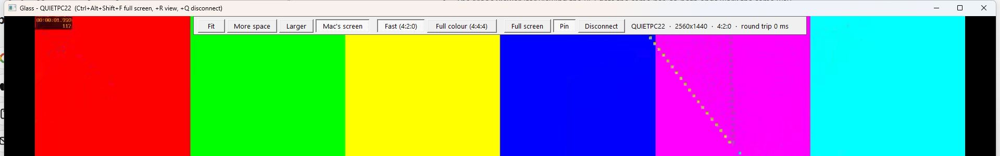
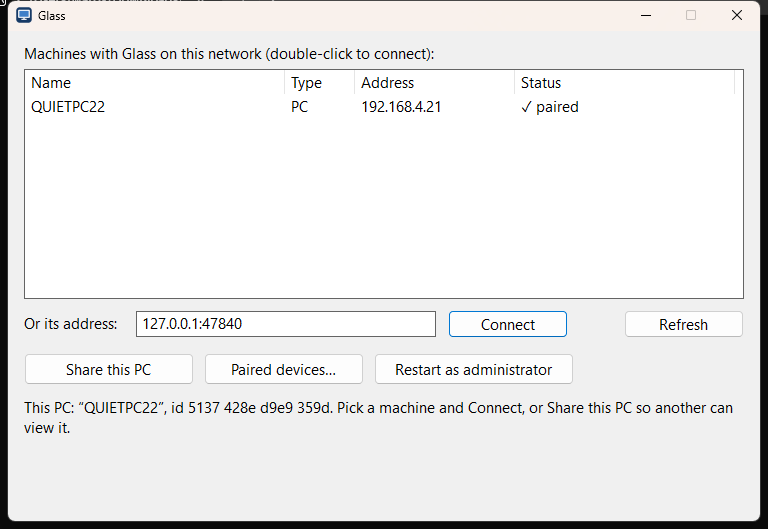
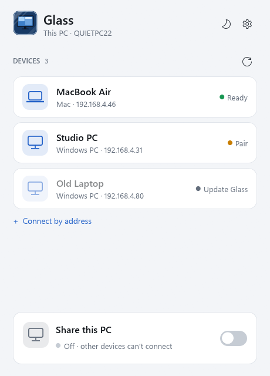
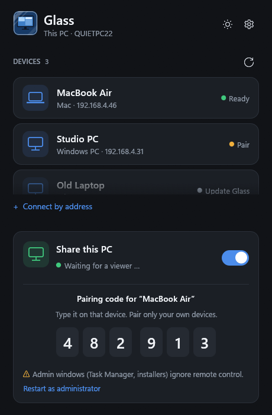

# M3d — Apps on both ends: results

**Status: in progress.** First piece built: the viewer's drop-down control bar
on Windows (`m3d-test1`). Still to do: the Windows app with tray, window and
settings; the Mac menu-bar icon; the Mac viewer's bar; the app icon.

## Control bar (Windows viewer)
- Move the pointer to the top edge of the viewer and the bar drops down.
  It hides about 0.7 s after the pointer leaves, unless pinned.
- It has:
  - View: Fit · More space · Larger · Mac's screen (current one pressed)
  - Colour: Fast (4:2:0) · Full colour (4:4:4) (greyed out if this PC can't
    decode 4:4:4)
  - Full screen / Window, Pin, Disconnect
  - Status: host, size, colour, round trip
- It never takes the keyboard (`WS_EX_NOACTIVATE`), so keys still go to the
  host, and clicks on it never reach the host.
- The keyboard shortcuts remain.
- Checked here against `glass serve` in a window; captured with
  `GLASS_SHOW_BAR=1 GLASS_DEBUG_SHOT=file.bmp`:

## Also in m3d-test1 (from M3c)
- The Mac host keeps only the newest frame. To check: dragging must not get
  laggier over time.
- 4:2:0 by default; 4:4:4 from the bar or Ctrl+Alt+Shift+C.

## m3d-test2 (built 2026-11-21)
- **Protocol v6:** `Welcome` carries the host's OS and capabilities.
  - The viewer picks keys by itself: Ctrl↔⌘ only across Mac/PC, as
    labelled between two PCs or two Macs. `--keys` overrides.
  - The bars grey out what the host can't do.
- **The PC host switches 4:2:0 ↔ 4:4:4 mid-session** (new NVENC encoder,
  StreamChange, IDR) and follows the viewer's preference from `Hello`.
- **The Mac viewer:**
  - It has the same drop-down bar: views, colour, full screen, stats, PC
    keys, pin, disconnect, status.
  - It handles StreamChange: a new decoder, picture shape and pointer scale.
  - It sends its screen size, so a Mac host can fit it (Mac→Mac).
  - It remembers the view per host and the colour choice.
- **CI:** a Mac→Mac run on the runner; the packaged app hosts a test pattern
  and its own viewer connects.
- **Exodus:** its password window doesn't appear in the stream. The app
  marks that window "no screen capture", and macOS leaves it out of every
  capture (screenshots, Zoom, Glass). It is still in front on the Mac, so
  typing reaches it. That's by design; Glass can't and shouldn't override it.

## m3d-test3: no connection loops (protocol v7)
- Each viewer's `Hello` lists who currently sees its machine, transitively:
  its viewers and theirs, up to 8.
  - A host process records this in `seen-by.txt` and refreshes it every 3 s.
  - Records older than 10 s are ignored, so a crashed host can't block
    anything.
- A host refuses (reject 7 "loop") when the viewer is itself, or when the
  host is on that list. That covers A↔B and longer chains like A→B→C→A.
- **Test:** `connection_loops_are_refused` checks:
  - PC views Mac, then Mac → PC: refused, and the PC host reports it.
  - PC → itself: refused.
  - After the PC disconnects, Mac → PC works.
- Also fixed: the Mac viewer's report showed "0x0" after the session closed.

## m3d-test4: the Glass window on Windows, icon, machine list
- **Double-clicking glass.exe opens the Glass window.** Its console is
  released, so no black window stays open. Arguments still run the command
  line.
- **The window:**
  - A list of Glass machines on the network, found with DnsServiceBrowse /
    Resolve. Each row shows name, Mac/PC, address, and paired or not; this PC
    itself is left out.
  - An address box, Connect, Refresh.
  - Share this PC (with the PIN shown large while pairing), Paired
    devices… (Forget), Restart as administrator.
  - Session results are shown, can be copied, and are saved next to
    glass.exe.
  - A tray icon: closing the window while sharing keeps Glass running; the
    tray menu has Open, Share/Stop, Quit.
- **The app icon** (`scripts/make-icons.py`, from the chosen design) is built
  into glass.exe and Glass.app.
- **The Mac's list** shows every Glass machine (Mac or PC) and leaves out
  this Mac. Hosts announce `os` in TXT.
- `glass find` lists hosts from the command line.
- Checked here: the window opens, finds a local host and shows it as a
  paired PC; captured with `GLASS_DEBUG_SHOT`:

## m3d-test6 (2026-11-21): the redesigned window

The Glass window was rebuilt for both apps: egui on Windows (Segoe UI,
Fluent icons), AppKit on the Mac (SF Symbols, system accent), with the same
palette. It has device rows (click to connect), a sharing switch with the
pairing code shown in large tiles, Settings behind the gear, and
System/Light/Dark themes. Checked here with `GLASS_DEBUG_SHOT` and
`GLASS_DEBUG_DEMO` (the device names are sample data):

 

**Mac → PC, real hardware** (MacBook Air host, RTX 4070 PC, home Wi-Fi,
81.8 s, the view and colour changed from the bar during the session):

| | p50 | p99 | max |
|---|---|---|---|
| capture → screen | 15.48 ms | 32.04 ms | 124.97 ms |
| input → screen | 30.77 ms | 134.10 ms | 137.02 ms |
| network | 2.18 ms | 86.64 ms | 123.89 ms |
| encode (Mac) | 5.30 ms | 14.00 ms | 34.43 ms |

- 0 lost frames, 0 decode errors, 3.0 Mbps average. The Mac sends only on
  change (27 fps average while in use).
- capture → screen p50 (15.5 ms) is better than M3c's 17.5 ms. The p99 and
  input → screen p99 tails come from Wi-Fi spikes (network p99 87 ms), which
  is M4's job.
- The present-interval max (9.3 s) is an idle screen, not a stall.
- **Bug found:** Copy results (and Ctrl+C in the results) did nothing,
  because eframe's clipboard feature was off. Fixed for m3d-test7: Copy was
  checked against the Windows clipboard here.
